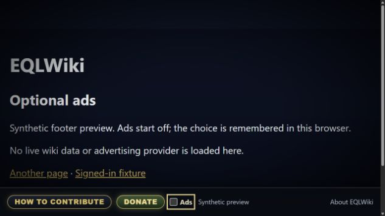

# Optional ads and staging footer preview

EQLImmersive places an **Ads** checkbox immediately after **Donate** in the
fixed footer. **Logged-out readers start with Ads on.** Turning them off says
exactly **“Ads disabled. Log in to save your preference”**. The choice is remembered
for the browser session, so readers do not have to repeat it on every page.
A first-party, wiki-scoped, host-only session cookie carries only `on` or `off`,
with `Path=/`, `SameSite=Lax` and `Secure` on HTTPS. It has no expiry or Max-Age and
is shared across this site's tabs. Normal session-cookie lifetime applies;
browsers that restore sessions can restore session cookies too. If cookies cannot
store a usable choice, sessionStorage can retain it in that tab. A valid cookie
is authoritative over an older tab fallback. Neither anonymous choice uses
localStorage or a long-lived cookie, and anonymous visitors make no preference API writes.

**Named accounts start with Ads off** unless their saved `userjs-eql-ads` option is
`on`. Their preference is saved to the wiki account, independently of the anonymous
browser session, and follows the account on future visits/devices. No anonymous
or legacy browser preference is imported or copied into an account. Existing
account/anonymous state for other features is untouched.

The account read verifies the current server identity using asserted
`userinfo` options before honoring On. Only a checkbox or close-button gesture
can save through native `mw.Api.saveOption`, with CSRF and the captured account's
`assert=user` / `assertuser` checks. Writes are serialized and the latest choice
wins; stale responses cannot enable ads. Startup, focus and page restoration
perform reads only. Failed or uncertain writes are not automatically retried.
Missing/malformed account values default Off; failed reads also stay Off.

If the browser or account cannot retain an opt-out, the current document keeps
the checkbox and local preview Off and explains the failure. It does not reload
into a stale saved On. Close that tab to end an already loaded provider; Google's
own anchor may remain until the tab closes. Retry or reload after resolving a
save failure to establish a retained preference.

`resources/ads.js` owns the preference and Google loader. No Google advertising
script, iframe, or ad request is created until the effective preference is On
**and** the server publishes valid production ad configuration. Without provider
configuration, an On preference creates no empty production ad area.
Unchecking removes the local preview immediately. When Google's script has been
requested and Off can be retained, it reloads the page to end that document's
advertising runtime. A change in another tab is also observed. Browser ad blockers
are respected.

The future production integration uses Google's supported regular bottom anchor
format. It does not fix a normal display ad to the screen or create a manual ad
unit. There are no real ads on login/account/special pages,
talk pages, editing/history/diff/old-revision views, missing or nonpublic articles,
staging, or local clones. `includes/Ads.php` checks the actual environment, title
and view before exposing configuration. Google code is not unconditionally added
to the footer, database `MediaWiki:` scripts, or page head.

## Review the footer dock on staging

Placement review is limited to **https://test.eqlwiki.com**. On a current existing
main-namespace article, including the Main Page, an On **Ads** preference displays
a synthetic bottom dock. It stays visible while scrolling, immediately
above the fixed Donate/Ads utility bar. Its creative area is 90px tall on desktop
and 50px at widths up to 900px, with a separate label and close button. The offset
matches the utility bar's 2.25rem desktop and 3rem mobile heights. End-of-page
padding includes the full dock height so the last article links remain reachable.
The dock is a sibling outside the utility bar's clipped container; it does not
move article content or change unrelated account state.

Closing the dock sets Ads Off, retains it for the anonymous browser session or
saves it to the named account, removes the dock and reserved space, and returns
keyboard focus to the Ads checkbox. Unchecking Ads does the same. Anonymous close
and checkbox opt-outs show the exact login notice above. Focus, visibility and
back/forward restoration re-read the appropriate session/account state. Failed
persistence retains the document-only Off behavior described above.

This preview contains no Google script, iframe, live creative, tracking call, or
ad impression. It illustrates space and controls; it does not predict Google's
creative, visibility, or actual anchor placement. Publisher and format settings
stay empty until the owner separately approves production activation.

The server publishes only `{preview:true}` when its trusted `Server` and
`CanonicalServer` are both exactly `https://test.eqlwiki.com`; the browser also
requires that exact origin. Even copied publisher IDs cannot activate Google in
this mode. Existing staging login and noindex policies remain intact. A harmless
preview can appear to an already authorized staging reader when anonymous wiki
reading is disabled; it grants no access and exposes no publisher configuration.
Special/talk/edit/history/diff/old-revision and missing-page views have no preview.

Keep `includes/Ads.php` and `resources/ads.js` outside the explicit production-URL
substitution list in `ops/staging-prepare.php`. Those files must retain their
separate production and staging allowlists. Git deployment does not install a
private host-script change; review the installed preparation script separately
if its rewrite list changes.

## Future production activation

Source deployment alone does not activate advertising. After separate owner
approval, the production site must be approved in AdSense and configured for
**anchor-only Auto ads**, with all other formats and automatic optimization off.
The loader uses Google's supported `data-overlays="collapsed-bottom"` setting for
regular bottom anchors. This setting enables bottom anchors and overrides their
dashboard position; it does **not** turn off other Auto ads formats. See Google's
[approved bottom-anchor code](https://support.google.com/adsense/answer/7478225).

Only then set the issued public publisher identifier in `$wgEQLAdSenseClient` and
explicitly set `$wgEQLAdSenseFormat = 'anchor'` in ignored production settings.
Both default to empty strings in `skin.json` and the sanitized example and remain
empty during staging review. A display-unit slot is not used or required by this
anchor integration. Existing display units need no deletion or account changes
for the staging preview. Never invent live IDs, commit account/payment data, or
enable real ad serving on staging.

Google controls its actual anchor and dismissal UI. The local preview's placement
above Donate/Ads does not establish that Google's anchor will leave those controls
uncovered. Verify supported-format placement and footer usability before owner
acceptance of production activation; local end padding alone cannot guarantee it.
No custom fixed-position styling is applied to Google's ads. Remove or route any
independently installed loader through the same effective-preference gate before activation; the
checkbox cannot stop code another extension, database script, tag manager or proxy
independently injects.

The Ads checkbox controls display. It is not a consent management platform or
permission for personalized advertising. Configure Google's supported consent
flow where required before serving ads; see its
[CMP requirements](https://support.google.com/adsense/answer/13554116) and
[consent setup](https://support.google.com/adsense/answer/7670013).
The root [`ads.txt`](../ads.txt) contains the owner-supplied Google seller record
for publisher `pub-6539165037996565`. Once published on production, confirm
`https://eqlwiki.com/ads.txt` serves that record, then follow Google's
[verification and review steps](https://support.google.com/adsense/answer/12169212).
This public record authorizes the seller and can verify site ownership; it does
not load ads or establish site approval. Ad-serving
configuration remains empty until the separate activation steps above.

## Check traffic and estimate revenue

Use the same date range for production browser pageviews and ad reports.
cPanel [AWStats](https://docs.cpanel.net/cpanel/metrics/awstats/) and raw logs
help separate requests, resources, known crawlers and likely reading. They do
not establish a reliable anonymous human count or wiki login state. Search
Console reports Google search clicks/impressions, not all site visits, internal
pageviews or ad impressions. Its search impressions are not advertising views.

For future browser measurement, collect pageviews with a logged-out/logged-in
classification and ad preference, without names or account identifiers. No
analytics collection is added by this feature. Exclude API/resource requests,
test traffic and staging. Unknown automation and measurement blockers still
make human counts estimates.

Only views whose effective Ads preference is On can earn revenue. Forecast from
anonymous human article pageviews, the fraction with Ads on, the fraction delivering
ads, and measured earnings per thousand of those monetized pageviews. Google
[page RPM](https://support.google.com/adsense/answer/112030) uses AdSense-counted
pageviews; do not substitute raw HTTP requests or multiply ad-impression RPM by
pageviews. If an effective RPM already includes opt-outs/blockers/unfilled views,
do not discount them a second time. Use actual network reports for earnings;
traffic alone cannot establish this site's RPM or future share of ad-enabled visits.

## Checks and release

Run `node ops/test-ads.cjs` with the development guide's jsdom runtime and
`php ops/test-ads-config.php`. These cover synthetic storage/network lifecycles
and server eligibility, including anonymous session defaults, asserted account
reads/gesture-only writes, queue and identity races, staging-only dock dismissal, footer breakpoint/
reserve contracts, anchor-only loader attributes and copied-ID isolation; they do not request real ads or prove live AdSense
approval, impressions, payment, or browser layout. Run JS/PHP syntax checks on
changed sources as well.

Browser checks should include keyboard focus and Space activation, narrow
320px/375px footers, reload/navigation persistence, a second tab, signed-in and
signed-out readers, no provider configuration, an anonymous fresh-session On
visit, and a new account's Off default. Confirm anonymous opt-out survives
navigation/tabs only for the browser session and shows the exact login notice;
confirm named-account saves survive a fresh browser without importing anonymous state.
Inspect network requests: Off must make no Google ad request. Use synthetic
provider responses for local lifecycle tests; never generate artificial clicks
or impressions against a live publisher as routine verification.
On staging, scroll a long article to its final links, check both sides of the
900px breakpoint plus 320px/375px widths, keyboard dismissal and reopening, and
the unobstructed utility footer. Verify there is no Google script, iframe,
request, or `adsbygoogle` unit. Synthetic CSS/DOM checks do not prove rendered
browser geometry or Google's eventual anchor behavior.

Deploy the source through a feature PR to staging, preserving the staging login
gate and disabled real-ad configuration. Review placement with the synthetic box
there; source changes do not activate production ads. Promote only reviewed
feature commits after owner approval. Production identifiers, AdSense account setup and
consent configuration are separate activation steps; Git deployment does not
perform them. No schema migration or database-page synchronization is needed.
